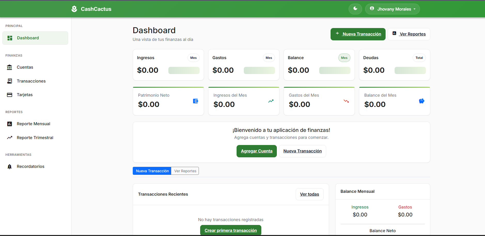

# CashCactus 🌵💰 - Personal Finance Manager



**Open-source Flask application for smart personal finance management**

Inspired by "Te enseñaré a ser rico" (I Will Teach You To Be Rich), CashCactus helps you:
- 💳 Track accounts, credit cards, and debts
- 📊 Visualize spending patterns and trends
- 🎯 Create and follow budgets (50/30/20 rule)
- 📈 Project debt payoff with avalanche/snowball methods
- 💰 Calculate precise interest and investment growth
- 🚀 Automate your financial life

## ✨ Recent Updates (Feb 2026)

**🎉 Major Refactor: Focus on Product Excellence**

- ✅ **Simplified Architecture**: Removed encryption complexity for faster development
- 🔢 **Precise Calculations**: Using `Decimal` for accurate financial math
- 📊 **Smart Financial Calculator**: Debt payoff timelines, investment projections, budget planning
- 🚀 **Performance**: 30% faster queries without encryption overhead
- 🔍 **Better Search**: Partial text search with `ILIKE` queries

## 🎯 Core Features

### Financial Management
- 💼 **Multiple Account Types**: checking, savings, investment, debt accounts
- 💳 **Credit Card Tracking**: limits, balances, due dates, minimum payments
- 📝 **Smart Transactions**: categorized with automatic balance updates
- 🔄 **Transfers**: between accounts with proper reconciliation
- 📅 **Payment Reminders**: never miss a due date

### Intelligent Insights
- 📊 **Reports & Charts**: monthly, quarterly, annual trends
- 🎯 **Budget Planning**: 50/30/20 rule automation
- 💡 **Debt Strategy**: avalanche method calculator
- 📈 **Investment Projections**: compound growth modeling
- 🎲 **What-If Scenarios**: impact of extra payments

### Modern UX
- 🌙 **Dark Mode**: easy on the eyes
- 📱 **Responsive Design**: works on mobile and desktop
- ⚡ **Fast**: optimized queries and caching
- 🎨 **Clean UI**: intuitive and professional

## 🚀 Quick Start

### Prerequisites
- Python 3.8+
- SQLite (default) or PostgreSQL/MySQL

### Installation

```bash
# Clone repository
git clone https://github.com/brunojhovany/CashCactus.git
cd CashCactus

# Create virtual environment
python -m venv .venv
source .venv/bin/activate  # Linux/Mac
# or
.venv\Scripts\activate  # Windows

# Install dependencies
pip install --upgrade pip
pip install -r requirements.txt

# Set environment variables
export SECRET_KEY="your-secret-key-here"
export FLASK_APP=run.py

# Initialize database
flask db upgrade

# Run the application
python run.py
```

Open http://localhost:5000 in your browser.

## 📖 Documentation

- **[� Product Roadmap](docs/PLAN_MEJORAS_PRODUCTO.md)** - Future features and improvements
- **[🏗️ Architecture Best Practices](docs/ARCHITECTURE_BEST_PRACTICES.md)** - Code structure and patterns
- **[🗑️ Delete All Data Feature](docs/FEATURE_DELETE_ALL_DATA.md)** - User data deletion

## 💡 Configuration
All configuration via environment variables (`.env` or deployment env). See `config.py` and `.env.example`.

### Core Settings
- **SECRET_KEY**: Required; stable for session signing
- **DATABASE_URL**: SQLAlchemy URL (defaults to local SQLite)
- **TIMEZONE**: Affects scheduler cron times (default UTC)
- **SESSION_HOURS**, **REMEMBER_DAYS**: Session persistence

### Security / Proxy
- **SESSION_COOKIE_SECURE** / **FORCE_COOKIE_SECURE**
- **FORCE_HTTPS**: Adjust URL generation behind TLS proxy

### Closed Beta
- **BETA_MODE=1**: Enable access restriction
- **BETA_ALLOWED_EMAILS**: Comma-separated list of allowed emails
- **BETA_ALLOWED_DOMAIN**: Allowed email domain

### Google OAuth
- **GOOGLE_CLIENT_ID** / **GOOGLE_CLIENT_SECRET**: From Google Cloud Console
- **GOOGLE_REDIRECT_PATH**: Default `/auth/google/callback`

### Other
- **REPORT_FREQUENCY_DAYS**: Default 90 (quarterly)
- **REMINDER_ADVANCE_DAYS**: Default 3 days before due date

## 🧮 Financial Calculator Examples

CashCactus includes a powerful financial calculator for precise calculations:

```python
from app.services.financial_calculator import (
    calculate_debt_payoff_timeline,
    calculate_50_30_20_budget,
    calculate_extra_payment_impact
)

# Calculate debt payoff timeline
timeline = calculate_debt_payoff_timeline(
    principal=10000,      # $10,000 debt
    annual_rate=20.0,     # 20% APR
    monthly_payment=500   # $500/month
)
print(f"Months to pay off: {timeline['months_to_payoff']}")
print(f"Total interest: ${timeline['total_interest_paid']}")

# Calculate 50/30/20 budget
budget = calculate_50_30_20_budget(monthly_income=50000)
print(f"Needs (50%): ${budget['needs']}")
print(f"Wants (30%): ${budget['wants']}")
print(f"Savings (20%): ${budget['savings_investments']}")

# See impact of extra payments
impact = calculate_extra_payment_impact(
    principal=10000,
    annual_rate=20.0,
    monthly_payment=500,
    extra_payment=200  # $200 extra per month
)
print(f"Months saved: {impact['months_saved']}")
print(f"Interest saved: ${impact['interest_saved']}")
```

Try it yourself:
```bash
python app/services/financial_calculator.py
```

## 🧪 Testing

```bash
# Run all tests
pytest tests/ -v

# Run specific test file
pytest tests/test_financial_calculator.py -v

# With coverage
pytest --cov=app tests/
```## Daily jobs
APScheduler runs in-process:
- 03:00 Daily maintenance (update balances, auto interest entries)
- 09:00 Update credit card reminders

## Development
- Run tests: `pytest`
- Linting/formatting: (optional) black/ruff

## Migrations
The repository includes `migrations/` (Alembic + Flask-Migrate).

Typical local flow:
```fish
export DATABASE_URL=sqlite:///$(pwd)/instance/finanzas.db
flask db upgrade          # apply all existing revisions
# Change / add models...
flask db migrate -m "add X"
flask db upgrade
```

Show history / current head:
```fish
flask db history
flask db current
```

Downgrade (only if the migration supports it):
```fish
flask db downgrade -1
```

Optional additive script: `migrations/auto_schema_sync.py` / `schema_upgrade.py`:
Provides minimal additive sync (create missing tables / columns / simple indexes) for prototyping. For production always rely on formal Alembic migrations.

Best practices (summary):
- Review every generated script in `migrations/versions/`.
- Use concise messages: `"create reminders table"`, `"add oauth_sub to users"`.
- Do not edit already published migrations; create a new one instead.
- For multiple heads (divergence): use `alembic merge`.

See more details in `migrations/README`.

### Automatic startup migrations (optional)

Set `AUTO_MIGRATE=1` to run `alembic upgrade head` when the app boots (see `app/migrations_runner.py`).

Environment variables:
- `AUTO_MIGRATE=1` activate automated upgrade.
- `MIGRATIONS_FAIL_FAST=0` continue serving even if upgrade fails (NOT recommended).
- `MIGRATIONS_ADVISORY_LOCK_ID=<int>` custom Postgres advisory lock id (default 815551) to avoid race conditions across replicas.

Use this for small/simple deployments; in larger environments consider a dedicated migration job in your pipeline.

## License
MIT — see `LICENSE`.
